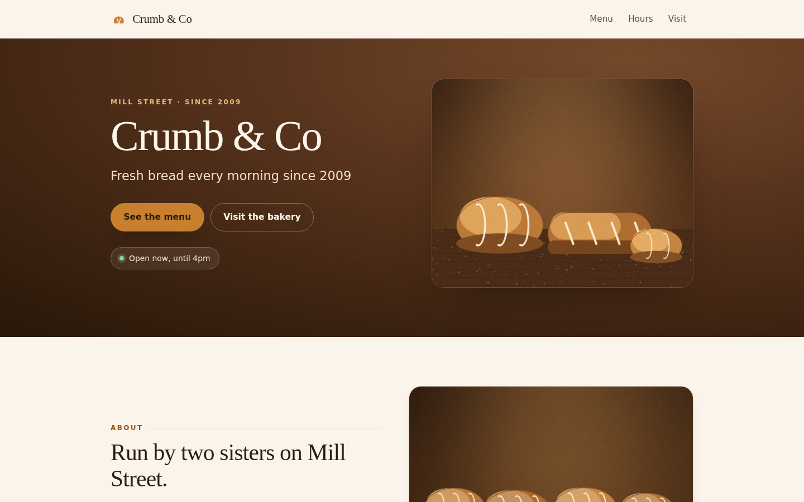
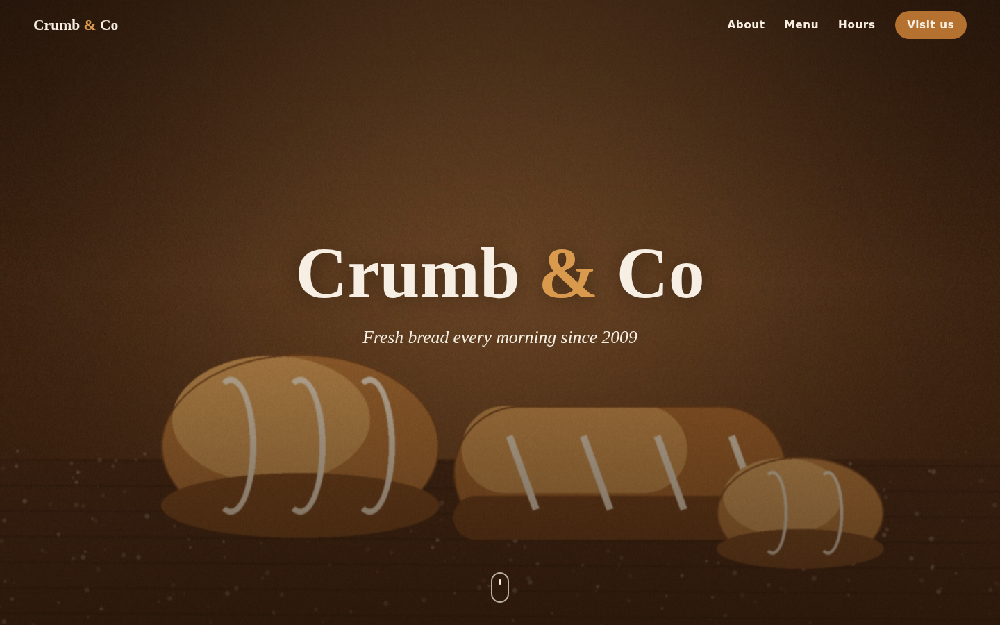
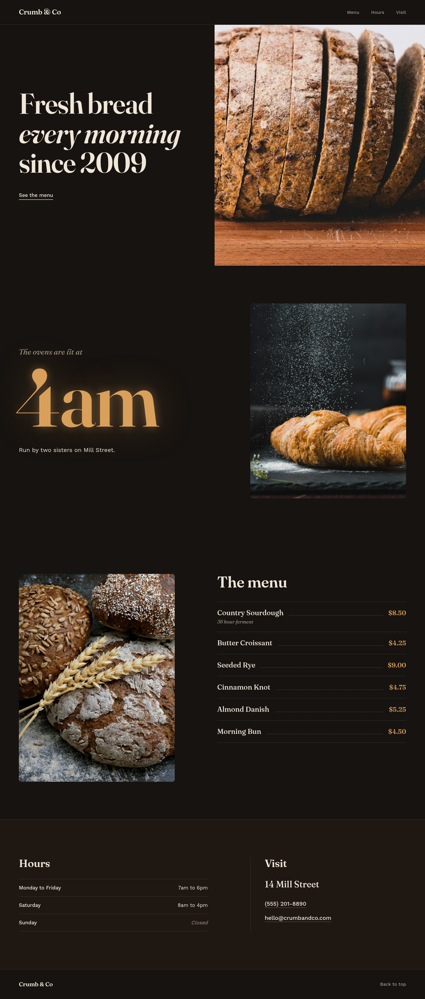

# Skulptor

Skulptor is an open Agent Skill that gives a coding agent a design team. Before any code is written, a designer model makes a design. Your coding agent builds it exactly, takes screenshots, and a critic model checks the build against the design.

It runs only on open weight models: **Kimi K3** designs and checks, **DeepSeek V4.1 Flash** builds. Both go through one Backboard API key.

**Live demo:** [Crumb & Co, a bakery page built with Skulptor](https://kaleidoscopic-horse-71483f.netlify.app/)

## The problem

Ask any AI model for a website and you get the same page: a dark hero with a centered title, two round buttons, cards with shadows, small labels over every heading. Short content gets repeated to fill the space.

I tested this. With the same bakery prompt and no skill, a cheap model (DeepSeek) and the top open design model (Kimi K3) built almost the same generic page.

| DeepSeek alone ($0.13) | Kimi K3 alone ($1.09) |
|---|---|
|  |  |

## How it works

Skulptor copies how a real design team hands work to a developer:

1. **Design.** `design.mjs` sends your request and your photos to the designer model. It writes a handoff: a spec (`design/README.md`) with colors, type, layout and exact copy, plus an HTML prototype and its screenshots.
2. **Build.** Your coding agent ports the prototype into your app exactly. It does not redesign.
3. **Check.** `screenshot.mjs` takes desktop and phone screenshots. `critique.mjs` sends the prototype and the build to the critic model, which lists at most 3 differences to fix.
4. **Fix.** At most 2 rounds, then a report with the cost of each step.

With the skill, the same bakery prompt gave a page with its own idea ("the page is set at 4am", with a glowing oven clock), no repeated content and nothing invented. The build matched the prototype almost pixel for pixel.

| Kimi's prototype | DeepSeek's build |
|---|---|
|  |  |

## Results

Same bakery prompt every time. Full logs, with costs and times, are in [experiments.md](experiments.md).

| Run | Models | Cost | Result |
|---|---|---|---|
| No skill | DeepSeek | $0.13 | Generic template, repeats itself |
| No skill | Kimi K3 | $1.09 | Generic template, repeats itself |
| Skulptor v2 | DeepSeek only | $0.05 | Its own idea (a morning timeline), some empty space |
| Skulptor v3 | Kimi K3 designs and checks, DeepSeek builds | about $0.70 | Its own idea, exact build, but sparse |

What I learned:

* Every model gives the same template from a short prompt. A stronger model alone does not fix it.
* Splitting the designer and the builder makes the build exact.
* A critic needs a picture to compare against. Vague critique ("improve it") gives random results.
* A good prompt reads like a client brief: all the facts, no style words.
* **Limit:** the designs are still too sparse, with empty space on desktop. Taste did not come from more rules.

## Setup

You need:

* [R-CLI](https://github.com/Backboard-io/Backboard-R-CLI), or any agent that supports Agent Skills (Claude Code works too: put the skill in `.claude/skills/skulptor/`)
* A [Backboard](https://backboard.io) API key
* Node 22 or newer, and Google Chrome or Chromium (for screenshots). No npm packages.

Steps:

1. Copy `.agents/skills/skulptor/` into your project's `.agents/skills/` folder (or `~/.agents/skills/` for all projects).
2. Add your key to a `.env` file in your project:
   ```
   BACKBOARD_API_KEY=your_key_here
   ```
3. Put any photos you want on the page in `src/assets/` or `public/`. To try the bakery example below, copy the photos from `examples/bakery/` into your app's `src/assets/`.

## Usage

Inside your app folder, start R-CLI with `deepseek/deepseek-v4.1-flash`. Load the skill with `/skills`, then write your request after `$skulptor`:

```
$skulptor Build a one page website for Crumb & Co, a small bakery, in this app. Use only this content:

- Name: Crumb & Co
- Tagline: Fresh bread every morning since 2009
- About: Run by two sisters on Mill Street. The ovens are lit at 4am.
- Menu: Country Sourdough $8.50 (36 hour ferment); Butter Croissant $4.25; Seeded Rye $9.00; Cinnamon Knot $4.75; Almond Danish $5.25; Morning Bun $4.50
- Hours: Monday to Friday 7am to 6pm; Saturday 8am to 4pm; Sunday closed
- Visit: 14 Mill Street. Phone (555) 201-8890. Email hello@crumbandco.com
- Photos: the images in src/assets (bread-hero.jpg, croissants.jpg, loaves.jpg)

Be ambitious. It must work well on desktop and on a phone.
```

A run takes about 25 minutes. The handoff and screenshots land in `design/`.

To try other models, set `SKULPTOR_DESIGNER_MODEL` or `SKULPTOR_CRITIC_MODEL` to any OpenRouter model ID that Backboard serves.

## What's inside

```
.agents/skills/skulptor/
  SKILL.md                  steps for the coding agent
  scripts/
    backboard.mjs           calls a model through the Backboard API
    design.mjs              designer: writes the handoff and prototype
    screenshot.mjs          desktop and phone screenshots with Chrome
    critique.mjs            critic: compares the build with the prototype
  references/
    designer-prompt.md, spec-template.md, design-rules.md, critic-prompt.md
```

## Credits

* [R-CLI](https://github.com/Backboard-io/Backboard-R-CLI) by Backboard (MIT): the agent that runs the skill.
* [Backboard](https://backboard.io): model access through one API key.
* [Kimi K3](https://huggingface.co/moonshotai) by Moonshot AI and [DeepSeek V4.1 Flash](https://huggingface.co/deepseek-ai) by DeepSeek: the open weight models.
* [Anthropic's frontend-design skill](https://github.com/anthropics/skills/tree/main/skills/frontend-design): the list of common AI design looks to avoid in `design-rules.md` is adapted from it.

Built for the Hacktoberfest 2026 DEV Challenge, Week 2, with help from Claude Code. The product itself runs only on open models.
